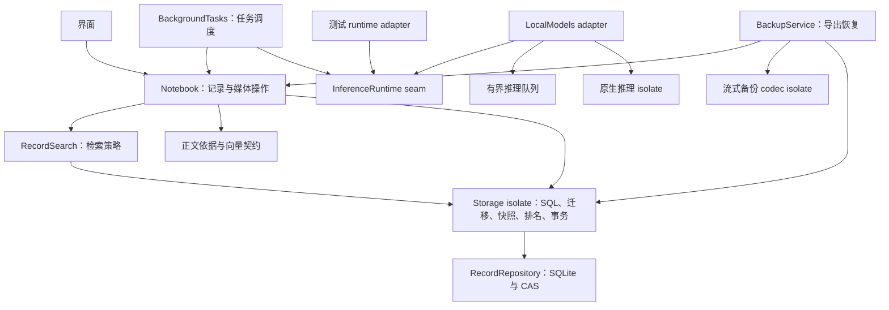

# 架构审查与重构结果

更新：2026-11-14。对象：实际Flutter/Dart、SQLite、模型调度、备份恢复、平台录音与UI。已验证批次按后续授权提交到功能分支；主分支整合及最终独立审查状态以 [交付报告](validation/2026-11-13-architecture-ui/final-report.md) 为准。正式应用未安装/清数据，当前验证仅用独立测试包及合成/公开夹具。以下旧阶段数值保留日期，不作为当前总数。

## 本轮最终架构补充

- 模块化单体保持：UI → Notebook/Backup/CaptureSession → source SQLite/media；source schema2与备份v2不变。任务、诊断、检索scratch分别是可失效的独立sidecar，不把诊断错误变成源保存失败。
- 当前UI使用每页最多40条、Unicode标题/片段有界的SearchHitSummary。排名只存ID/分数/时间于私有scratch SQLite，256MiB预算、2MiB页缓存、最多两个query context与五分钟空闲TTL；资源不足明确失败并保留源数据。旧全结果API为兼容保留，不用于新搜索列表。
- durable jobs按source修订/模型代际/租约恢复；源提交先于任务确认，失效/失败不会复活记录。SQLite owner锁保护同进程第二实例；推理close等待真实在途finally，录音期间暂停新推理。
- 有界诊断只允许封闭枚举/数值/随机标识：5MiB/7天、队列256；导出前预览，绝不包含正文、查询、音频、凭证或密码。
- 原生录音owner在Android前台service/process生命周期内独立于Flutter engine；每次会话有UUID、单调时钟120秒上限、有效WAV和持久日志。实际锁屏、强杀四阶段、引擎销毁后同owner继续PCM和一次导入有独立包证据；iOS实现和真机门禁未完成，不默认启用。
- 加密只用标准age格式与固定Rust/Go互操作夹具，认证到EOF前不合并原库；取消、空间、KDF资源与损坏边界有证据。原型仅打入受控备份测试目标，普通release不包含age库。未通过Gate-B前仍明确标注明文备份；不声称本地SQLite/WAV已应用层加密。
- UI按批准稿使用中性深浅主题、顶部查找/写文字与单一底部录音，收起不取消，错误和恢复有明确出口；iOS玻璃因原型环境不可用降级实色，Android Material3。系统偏好adapter与实际键盘/字体放大分别验证，不能把截图视为原生玻璃或屏幕阅读器体验验收。

完整结果见 [各项验证与限制](validation/2026-11-13-architecture-ui/final-report.md)。后续历史段落中的“尚无分页/诊断/加密原型”描述属于当时阶段；本补充是当前状态。

## 结论与适用范围

这是本地优先的单用户移动应用。保留模块化单体、SQLite 和显式依赖注入的方向合理。目前不能承诺“安全、高性能、可扩展、可维护、可进化、可插拔”已经全部达标；这些要求必须有威胁模型、数据规模和设备指标。此前确认的大库恢复事件循环阻塞已在本次后续重构中处理，具体实现与实测见下文。

| 要求 | 当前判断 | 依据与限制 |
| --- | --- | --- |
| 安全 | 核心数据一致性与隐私约束有防护和回归 | 私有存储、平台备份排除、凭证安全存储、逐次云端正文确认、CAS、事务、恢复校验；文件及导出包没有应用层加密，不能覆盖设备失陷或副本泄露 |
| 高性能 | 十万条主机合成基线已测，手机指标待验收 | 数据库、恢复事务、快照、检索排名在 worker；首页/追加分页。仍需真机规模测试；推理会话每次任务重新初始化 |
| 可扩展 | 能继续扩展当前单机产品，数据规模扩展有限 | 首页按需分页、摘要传输有界；常规检索使用字符倒排/磁盘 HNSW；冷查源扫描仍 O(N×D)、全命中返回 O(H)，未实现跨设备同步 |
| 可维护 | 本轮改善了不变量的 Locality | 录音并发、检索策略、推理生命周期、整理输出校验集中到各自 module；存储所有权集中到 worker，图编码/布局集中在 CompactGraphStore；首页内容通知与派生通知分开 |
| 可进化 | 已有明确机制，未来变更仍须逐版本验证 | schema/version、冻结 v1 夹具、迁移事务与快照、原始资料和可重建缓存隔离、备份 reader 版本、模型代际；不能为“从头开发”而丢弃已有数据契约 |
| 可插拔 | 在实际变化点可替换 adapter | Transcriber、Embedder、Organizer、MicrophoneInput、InferenceRuntime；真实 SQLite 用临时库测试。替换模型仍要维护维度、向量空间、算法指纹、许可与平台适配 |

“可插拔”在这里指通过 interface 替换实现。当前不需要动态加载第三方插件，也不需要为只有一个实现的本地存储再加一层通用仓储框架。

## Module、Interface 与 Seam

- `Notebook` 的 interface 是保存、编辑、删除、录音、转写与整理等业务操作，隐藏媒体日志、修订与异步写回规则。这些行为有 Depth，不能仅按文件行数把它拆成多个透传 module。
- `RecordSearch` 集中归一化、余弦比较、代际检查、分页、排序和关键词降级。调用者不需自行重复这些约束；测试从 `Notebook.search` 穿过同一 seam 验证结果。
- `InferenceRuntime` 给后台调度提供能力就绪、模型代际和推理，不暴露模型文件、下载器或原生引擎类。生产 adapter 与独立测试 adapter 已分别接入。
- 第三方网络与麦克风使用可注入 adapter；SQLite 是本地可替代依赖，直接用临时真实数据库验证事务，不再叠加假数据库 interface。
- `BackupService` 的恢复编排已迁到 `app/backup.dart`；codec、暂存准备与 SQLite 合并留在数据层，通过 Storage 的异步 interface 调用。数据层不再反向依赖 Notebook。

## 本轮确认并修复的问题

| 问题 | 触发与影响 | 修复位置/验证 |
| --- | --- | --- |
| 同一录音并发保存，或保存与丢弃交错 | 文件异步操作前的存在性检查无法互斥；可能出现重复 rename、保存失败或删除正在保存的文件 | `Notebook._withCapture` 按录音串行化保存/丢弃；真实 WAV 并发回归 |
| 查询与索引模型代际混算 | 查询推理等待期间切换索引模型，旧查询向量可能与新文档向量比较 | `RecordSearch` 捕获模型代际，变化后清除语义分数并降级关键词 |
| Embedder interface 缺少可执行的数值契约 | 非单位向量影响排名，零向量被接受，非法查询向量被误报为索引未就绪 | `unitVector` 统一校验有限、非零、维度上限及稳定归一化；余弦比较不依赖 adapter 的向量幅度 |
| 分页读取后的失效结果 | 让出执行时间后，之前命中的正文可能已修改或删除 | repository 的内容代际使检索重扫；结果不携带向量工作载荷 |
| 推理任务无限排队且无关闭契约 | 暂停录音期间或高频请求可能积压；关闭会留下待执行工作 | 最多 64 个等待任务，满时明确失败；关闭拒绝待执行、新增及在途结果，在途原生计算自行释放资源 |
| 后台调度依赖具体引擎、错误状态绑定不完整 | ready I/O 异常成为未处理 Future；旧代际失败导致同修订记录不再索引 | 依赖 `InferenceRuntime`；收口 ready 异常，下一次资料/就绪通知重试；失败键包含修订和模型代际，清除已删记录条目 |
| 整理业务校验依赖具体云端 adapter | 替换 adapter 可跳过原文依据校验；旧整理结果可能被标成新模型代际 | 输出校验移至 domain，并在 Notebook 执行；写回带启动时模型代际 |
| 转写输出缺少原始资料大小校验 | adapter 返回超过 100,000 字的转写可落入原库，却超出备份可恢复契约 | Notebook 在写回前拒绝超长输出，记录可重试的失败状态并保留音频 |
| ZIP 预检后仍全量构造 Archive | 大量条目的小包仍产生高内存和无关文件 I/O | 逐 header 读取；先清单与分块，核对引用后才写音频；本地与中央头均限制 STORE，显式开启 CRC 和严格错误处理 |

关键回归位于 `test/architecture_contract_test.dart`、`test/inference_queue_test.dart`、`test/background_tasks_test.dart`、`test/background_runtime_test.dart`、`test/backup_entry_validation_test.dart`。ZIP 流式改动中的 CRC 设置遗漏被第二次独立审查发现，已通过 v1 manifest 单字节篡改用例完成红绿验证。

## 未解决的性能与演进问题

### 已完成：专用 storage isolate 与异步读取

`Storage` 持久 worker 独占正式 SQLite 连接，承担打开/迁移/校验、读写、快照、检索扫描排名和恢复最终事务。`Notebook` 读操作已改成 Future；首页每页 40 条、600 字符摘要，详情按需读完整原文及追加分页；后台每批读取 32 个待处理项。UI 不再获得数据库 handle，也不在列表行读取整库。

最终恢复事务仍原子提交。准备阶段允许普通读写在安全 await 处执行；进入最终事务前处理取消，事务期间检查持久取消标记。期间新数据库请求在 worker 等待，主 isolate 不等待 SQLite 锁。关闭排空已接收操作并处理媒体租约，原 schema 2、备份格式 2 和冻结 v1 夹具保留。

此前独立审查在 Mac ARM 恢复 20,000 条纯文字记录：总计 2613 ms，10 ms 定时器最大事件间隔 1055 ms。重构后完整主机测试的一次实测为总计 4193 ms、最大事件间隔 39 ms。两次执行负载不同，不能用总耗时计算固定性能倍数；实质改进是数据库事务执行期间 UI 事件循环持续响应。回归同时断言恢复期间新增及原有资料保留。

异步化新增的删除/租约窗口、关闭后新发起云端请求、首页索引通知使分页收缩，以及取消标记与目录清理竞争均建立回归并修复。首页数据读取失败可重试，刷新保留已加载窗口及滚动位置，代际/请求序号防止混入旧回包。

### 仍保留的规模与推理限制

- 2026-11-13 已以字符倒排和磁盘 HNSW 代替常规逐条检索；关键词保持精确，语义候选有界且近似。冷建/启动对账仍需读取源库，损坏索引时保留明确的原资料扫描降级。兼容全结果API仍与命中数相关；新UI已用有界摘要分页，十万条宿主全命中/Android一万条分页验证见本轮报告，十万条真机验收仍缺。
- 首页按用户滚动逐步累积已加载摘要，刷新成本与当前已加载窗口相关；不承诺无限容量或所有设备的固定帧率。最终长事务仍会延迟其他数据库请求，当前目标是保持 UI 和录音文件落盘响应，并保持数据原子性。
- `_recognizeOffThread` / `_embedOffThread` 每次新建 isolate、读取模型或词表并初始化会话。是否常驻 worker，仍应根据真机冷/热延迟、峰值内存、生命周期和代际切换实测决定。
- ZIP 已移除全量 Archive 对象；文件名、引用集合和 manifest 仍随条目数增长。百万条目上限、ZIP64 支持不能替代手机 RSS、空间和超过 4 GiB 实包测试。

### 验证与安全的实际边界

- 当前没有性能目标设备的延迟、内存、耗电及十万条容量验收。荣耀 Magic8、iPhone 17 的硬件差异仍需实测；本轮 Android 存储集成结果见交付记录；没有进行真机或 iOS 完整构建验收。
- 已有存储迁移、媒体清理意图、原文与派生缓存分离、备份冲突处理等机制应保留。新模型、新字段、新备份版本仍须增加独立迁移/兼容夹具与故障注入。
- 原文引用检查仅证明派生字段存在原文依据，不证明模型保留了否定、条件或正确语义；整理及日历仍要人工核对。
- 本轮已有不含原文或密钥的有界诊断；实际指标与隐私边界见diagnostics报告，不承诺所有native/OEM故障均能定位。
- 本地私有文件与未加密导出包的保护依赖设备与外部存储。若后续产品威胁模型要求设备丢失或导出泄露保护，应单独设计加密、密钥恢复与用户体验，不能由 SQLite/WAL 推导出加密结论。
- Android 的 Release 配置仍使用 debug 签名，只适合当前试用。公开分发前需使用受保护的正式签名与发布流程；这次未创建或替换签名密钥。

## 建图后尾延迟与数值边界（2026-11-13）

- 确认128候选的源库SELECT为389次；用16条完整记录批读收口模型元数据与SQL执行，降为29次，仍按原ANN顺序评分。原`get`、数值算法、schema/cache/backup/模型与ANN参数不变；坏缓存重复key进入原有降级重建。
- 关闭GC日志的完整前后冷建对照，同进程p95=21.798→17.320ms、最大22.612→18.269ms；独立warm=21.307→17.309ms。单轮冷建636.001→632.391秒，不归因为固定建图收益。warm峰值92.156→93.563MiB，成本保留。历史26.374ms未稳定复现；另一次GC诊断49ms不可直接当正式基线，非CPU等待的具体内核来源未唯一定位。
- Float64/Float32位串、signed zero/subnormal/有限边界/NaN/Infinity/非对齐回环与旧算法差分补齐，3个数值mutants和去掉坏缓存guard的mutant均RED→恢复GREEN。冻结legacy同分同时间顺序、显式vectorRevision断言补齐限定只读审查minor；没有重要评审问题或重复复审。
- 主机220Flutter+15Python/analyzerclean；Android API36/SQLite3.54.1 Debug9检索/数值/批量+4存储，ARM64 Profile AOT9合同及普通Release/ABI/包名检查通过。12查询的全部有序结果/score位串/片段/修订一致；全部原源库与图内容一致，正式8文件指纹不变；依赖/旧冻结夹具不变，无正式安装/提交/推送。
- [完整证据与限制](performance/search-tail-100k-2026-11-13/README.md)。大organization实际峰值、真实big-endian、iOS和真机长期行为未在本轮验收，短文本p95不作为全设备保证。

## 内存与首次查询优化（2026-11-13）

- 针对源向量装箱、归一化双列表及对账 SHA 的通用字节列表做局部修改；分别使用 owned Float32、单份 Float64 和 Uint8 缓冲区，保留计算精度与原指纹。源库/sidecar 明确采用连接内约2MiB建议页缓存，不使用实验性 raw SQLite API、手动GC、量化或较小 ANN 参数。
- 3 组成对首查中位数 2486.662→995.267ms，首查峰值RSS中位数61.250→27.766MiB；3次独立warm进程峰值中位数102.641→92.141MiB，语义p95中位数23.420→21.439ms。完整冷建664.082→647.563秒，峰值104.375→91.328MiB，索引仍471.902MiB；Recall@10全部1.0。
- 冷建进程内热语义p95从22.808→26.374ms，独立最终warm则22.176→22.146ms。保留全部尾延迟与分步失败记录，不将单次差异写成固定收益或完全归因；先前单次首查慢10%也未被证实为紧凑布局引入的扫描回退。
- 完整源库字节、所有文档指纹/图邻接/Float32块与上轮一致；正式库/WAL/6WAV共8文件哈希不变。213Flutter+15Python+analyzerclean，Android API36/SQLite3.54.1 的2检索+4存储场景、ARM64Release/ABI/包名验证通过。无正式安装、提交/推送或依赖/冻结夹具变化。
- 一次新上下文限定增量独立审查无Critical/Important；minor为数值相等测试未穷尽signed-zero/subnormal位模式，不宣称任意输入逐位一致。真实big-endian、iOS完整构建、长期真机/中文质量仍不在本次验收内。详见 [原因、候选与原始证据](performance/search-memory-100k-2026-11-13/README.md)。

## 紧凑索引最终结果（2026-11-13）

- 最终完成 100k/512D AOT 冷建、独立 warm 和全命中测量。后台准备 987.890→664.082 秒（减少 32.8%），sidecar 758.434→471.902 MiB（减少 37.8%），独立热语义 p95 29.553→22.176 ms，关键词 p95 0.349→0.278 ms，12 个查询 Recall@10 均为 1.0。向量精度与 HNSW 参数保持不变。
- 冷建峰值 RSS 102.375→104.375 MiB，独立 warm 峰值 89.000→102.953 MiB；首查 2.213→2.434 秒，全命中输出 3.656→3.853 秒。内存与大结果输出没有全面改善，不将布局优化写成所有场景的性能保证。
- `CompactGraphStore` 在 HnswStore seam 封装整数/二进制邻接与独立 Float32 块，整数词典合并频次写入；普通 rowid 向量块避免大 BLOB 的 WITHOUT ROWID 索引载荷读取热点。缓存格式 3 的已知 v1/v2 物理重建与未知/未来库保护均有回归，原始 schema2/backup2 不变。
- 上轮独立审查发现的槽位游标回退覆盖向量已 RED→GREEN 修复，淘汰异常 close 补齐；本轮未重复派发复审。最终测量使用修复后代码，源码指纹和探索性中断日志均保留。本轮另将一项 UI 测试改为等待实际列表行，避免把编辑器文字和帧空闲误认为保存/刷新完成；产品代码未改。
- 最终完整门禁 209 Flutter、15 Python、analyzer clean；Android API36 / SQLite3.54.1 的 2 检索+4 存储场景通过；ARM64 Release 51,187,617 bytes 构建及包名/ABI检查通过，未安装正式包。正式主库/WAL/6 WAV共8文件与重构前指纹一致，合成源库 cold/warm/全命中前后哈希相同，依赖未变，Diff检查通过。无提交/推送。
- [最终报告与原始证据](performance/search-compact-100k-2026-11-13/README.md) 记录完整比较、决策、失败和局限。真机、iOS、自然中文人工标注集、长正文、大结果分页和功耗仍未验收。

## 首次结果与十万条验证（2026-11-13）

- 冷查询直接分页源库，后台拥有文本准备和图续建 Future，查询优先、关闭停止续建。缓存 v2 使用整数倒排和短图标识，并在事务末合并邻接写入；原 schema 2、备份 v2、原音频和向量保持不变。
- 真实 100k/512D AOT 验证：首查 2.213s；最终 beam=8、ef=200 热语义 p95 29.553ms，12 个查询各重复 5 次的 Recall@10=1.0；选择性关键词 p95 0.349ms。构建进程峰值 RSS 102.375MiB、最终查询复测进程 89MiB；sidecar 758.434MiB。全命中100k结果单次3.656s、返回结果保留时RSS99.266MiB。
- 全量后台准备 987.890s，首查不等待它。冷建记录与最终查询复测分开保留：构图未改，只将贪心上层改为小 beam，故同图复测有效，不能宣称重做了第二次冷建。此前 ef200/upper1 只有 0.9167；单纯扩大 ef512 无效，真实图路径与小图 RED→GREEN 指向上层局部极小。
- 最新 `tool/check.sh`：196 项 Flutter、15 项 Python、analyzer clean。独立复审发现并修复自等待、fallback 过早释放生命周期、准备中压缩清图、派生更新饥饿及冷测夹具复用等问题；限定复审通过。原始 fixture 数据库在冷建、调参和全命中测试前后 SHA-256 相同。
- 修复上层 beam 后重跑 Android API36 的真实离线 BGE/持久检索/坏图恢复与同日分页 2 场景、存储升级/备份/未来库拒绝/异步关闭 4 场景，均通过；正式库/WAL/音频等 8 文件 SHA-256 未变。ARM64 Release 51.2MB 构建及包名检查通过，未安装到正式应用。依赖锁文件未变；最终 Diff、原始指标 JSON 和空白检查通过，无 Git 提交/推送。
- 完整原始指标、索引空间构成、全命中输出成本、RSS 定义与复现命令见 [性能报告](performance/search-100k-2026-11-13/README.md)。图存储空间、全部命中传输、真机电耗、自然中文质量与 iOS 完整构建仍是明确边界。

## 第一轮索引检索验证（2026-11-13）

- 字符倒排/HNSW、durable 向量队列与 storage worker 集成完成；不新增生产依赖，不改变原 schema、备份版本或冻结夹具。细节见 [数据存储契约](data-storage.md#离线检索访问路径2026-11-13)。
- `tool/check.sh`：188 项 Flutter、15 项 Python 通过，`flutter analyze` 无问题。覆盖中文短/长子串、标点、原文片段、模型/维度、迟到 CAS、外部正文/向量替换、缓存故障后重试、合法 JSON 的错误图结构、entry 丢失、未来缓存保护、离线日期查找、4500 条更新溢出期间并发查询，以及图构建期间关键词旁路。
- 独立只读审查指出并已修复：词典删除的全表扫描；不完整的坏图恢复；全文本对账期间的并发关键词漏查；日期语义候选未使用日期索引；日期关键词全 posting 扫描与同日分页的重复扫描。最后一轮 scoped 复审通过；实际包 SQLite 和 Android 均断言 tuple seek 查询计划。
- 真实 SQLite 10k/64D 合成数据：关键词旧扫描/倒排 p95 为 57.699/0.496 ms；语义 p95 10.461 ms、Recall@10=1.0、平均距离计算 292.92 条。关键词冷建 3010 ms，语义图首次准备 29586 ms，重开对账 460 ms；sidecar 54,636,544 bytes。全部是主机夹具，不代表自然中文语义质量、真机时延或 HNSW 所有分布的复杂度保证。
- Android API36 / SQLite 3.54.1：2 个检索业务场景与 4 个存储业务场景通过，独立 `.test` 包；检索使用真实离线 BGE、HTTP 禁用且不采集麦克风。正式应用库、WAL、音频等 8 个文件 SHA-256 一致。
- Android ARM64 Release 构建通过，约 51.2 MB，包名核对为 `app.nianxia.nianxia`，仅生成安装包；仍使用试用 debug 签名。`git diff --check`、新增文件空白检查、依赖清单/锁文件未变检查通过。正式包未升级、无 Git 提交/推送，已有工作区改动保留。
- 图冷建成本、大量命中的结果传输、十万条容量、iOS 完整构建与双平台真机仍是明确的验收边界。

## 此前验证记录（2026-11-12）

修改前主机基线：122 项 Flutter 测试通过。本轮对录音竞态、数值契约、模型代际、后台就绪异常、ZIP 引用及 CRC 等先跑出失败，再修复。

1000 条短记录、20 次关键词查找的主机测试曾分别观察到 P95 17.833 ms（修改前）和 9.358 ms（修改后定向执行）。执行时的并发负载不同，不能据此宣称固定提升倍数或手机性能达标。

最终验证：

| 命令 | 结果 |
| --- | --- |
| `flutter test --reporter expanded` | 154 项通过，包含超过 512 MiB 的真实备份往返、迁移中断和新增架构回归 |
| `flutter analyze` | 无问题 |
| `python3 -m unittest discover -s tool/tests` | 14 项通过 |
| `flutter build apk --release --target-platform android-arm64` | 通过，约 51.1 MB；未覆盖安装正式包或发布 |
| `git diff --check` | 通过 |
| 保护模式 Android `--target storage` 集成 | API36 / SQLite 3.54.1，4 个业务用例通过；独立 `.test` 包 |
| `visual_test.dart` 中文字体截图检查 | 5 项通过，生成深浅主题/详情/搜索/表单等 14 张截图；已目视检查首页、详情、搜索 |

Android 集成前后，正式应用主库、WAL 和音频等 8 个数据文件 SHA-256 一致；正式包未卸载、清数据或覆盖安装。

Flutter 使用 README 记录的本地工具链路径。构建仍提示 Gradle/AGP/Kotlin 后续支持版本警告；未跳过构建依赖检查，未在本轮升级依赖。iOS 当前只有 Command Line Tools，未进行完整 Xcode 构建或真机验收。

没有新增生产依赖或数据格式版本，没有 Git 提交/推送，没有改动正式笔记数据。之前已有的未提交改动均保留。
