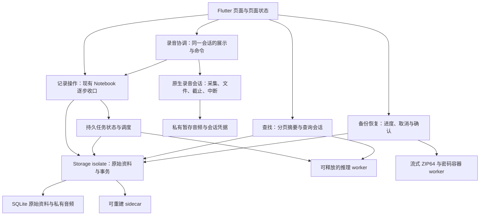

# 念匣架构与交互重构设计

状态：用户已于 2026-11-13 确认整套架构与 UI 方案定稿，要求先制定实施计划，优先验证锁屏录音和加密备份。设计已批准不代表实现已验证。日期：2026-11-13。

## 目标

让用户能放心记录中文短语音与文字，可靠保存、离线转写和找回内容，并直观处理失败、恢复与日历事项。可靠、安全、性能、可维护、可观测和可验证须落实为具体行为、设备测量和验收证据，不作为未经验证的产品承诺。

用户允许彻底重构；是否重写、保留或替换模块由现状证据和目标决定。已有用户资料、未提交改动、数据格式与可靠性回归不能因重构授权被覆盖或丢弃。

## 已确认决定

1. 近期交付以可靠自用和小范围试用为目标，同时保留公开发布需要的质量边界；没有将本轮验收提升为公开上架。
2. 针对设备锁正常时的手机遗失、应用间隔离、恶意备份文件和云端误传设计；不把应用私有目录本身描述为应用层加密。
3. 核心流程一致、平台体验分别适配，见 [ADR-0002](../../adr/0002-platform-adaptive-interaction.md)。
4. 一万条为日常容量验收，十万条为规模压力测试；音频另按总时长与磁盘占用设预算。十万条合成文本/向量不能代替十万条带音频记录的容量验证。
5. 用户主动开始后，锁屏或切换应用仍能完成两分钟内的记录录音；来电或音频中断时保存有效片段，系统终止后提供恢复，不保证持续采集或全部未落盘音频无损。
6. 优先提供密码加密完整备份，本地数据库和音频先验证并落实系统保护，首版不增加独立应用解锁密码。无产品密钥托管，忘记密码无法恢复该加密备份，见 [ADR-0003](../../adr/0003-password-encrypted-backups.md)。
7. 可审计指关键操作结果、来源版本、故障和恢复过程可追溯；首版不包括永久正文历史或防篡改审计。本地诊断有容量与保留期限，排除正文、音频和密钥，诊断导出由用户主动触发。
8. 临时语音查询只在前台采集，锁屏/切后台结束采集；返回后再确认查找，不自动成为记录。它不沿用记录录音的后台持续采集策略。
9. 保留独立的未加密文本/音频可读导出入口，并明确提示；完整备份默认密码加密。
10. 用户选择上轮按显示顺序的第 3 组首页：顶部查找框、底部单一“记一下”主按钮、顶部可见“写文字”和设置入口；继续细化深色主题、录音及查找页面。[已选浅色首页](../../design/ui/2026-11-13/home-light-selected.png)。

现有已确认的本地优先、可选云整理和用户自带 Key 边界继续适用，见 [ADR-0001](../../adr/0001-local-first-optional-cloud.md)。没有新增账号、自动同步、常驻云端或后台批量上传需求。

## 实际基线与证据范围

当前工作区已实现 Flutter/Dart 模块化单体、专用存储 isolate、SQLite schema 2、备份 v2、可重建检索 sidecar，以及本地语音和向量推理。项目规则中“尚无产品代码”的描述已过时；本轮以实际代码为调查基线，不据此自动修改长期规则。

- `lib/data/storage.dart`：持久存储 worker 与异步请求边界。
- `lib/data/schema_migrations.dart`：迁移、快照与原始字段校验。
- `lib/app/notebook.dart`：录音保存、恢复、修订和异步写回编排。
- `lib/data/record_search_store.dart`、`lib/data/search_index.dart`：关键词与语义检索及回退。
- `lib/platform/local_models.dart`：推理队列、ASR 与 embedding 执行。
- `lib/platform/capture_controller.dart`：当前在隐藏、后台、锁屏等条件下结束录音；不能将其描述为已经支持锁屏持续录音。
- `lib/app/background_tasks.dart`：后台任务状态和重试处理，尚缺统一诊断出口。

已有性能与回归报告见 [架构记录](../../architecture-review.md) 和 [首查与内存报告](../../performance/search-memory-100k-2026-11-13/README.md)。这些是既往执行证据；本轮尚未重新运行产品测试，不代表本轮独立验证通过，也不替代真机、自然中文质量或 iOS 验收。

## 推荐架构与职责

本节架构方向已获用户整体确认。保留 Flutter 模块化单体、SQLite 和显式依赖注入；平台敏感的录音会话由 Kotlin/Swift 分别持有。首版不为重构引入状态管理框架、ORM、向量数据库、通用插件平台或业务服务端。实际实现若发现必要依赖或兼容变化，应在实施计划中明确。

全原生 SwiftUI/Compose 能更直接采用系统新控件，但需维护两套页面、状态和平台接入，并重新证明已有记录流程。保留全部 Dart 录音链路改动更小，却无法只靠页面生命周期满足新的后台收尾要求。推荐共享现有产品与数据逻辑，仅将必须拥有系统生命周期的录音职责放入原生；玻璃材质本身不足以构成全量重写理由。

### 模块 interface 与所有权

| 模块 | 对调用方提供的能力 | 隐藏在 implementation 内的复杂度 |
| --- | --- | --- |
| 页面状态 | 读取状态、发送用户意图、观察结果 | 请求代际、过期回包、加载/空/错误状态；页面不操作 SQL、模型队列或音频文件 |
| 记录操作 | 保存、编辑、追加、删除、接收已结束录音、请求派生处理 | 媒体与元数据一致性、CAS、父子关系、删除屏障和可恢复失败；保留现有深层行为 |
| 录音协调 | 开始、读取当前会话、停止保存、丢弃 | 原生会话重连、单会话互斥、重复快捷动作、解锁后入库及用户反馈 |
| 原生录音会话 | 按 sessionId 幂等控制、查询实际状态、订阅有界状态/音量事件 | Android FGS、iOS audio session、PCM/WAV、独立样本上限、单调时钟截止、中断与恢复凭据 |
| 查找 | 查询首屏、取下一页、取消/失效 | 关键词与语义融合、来源版本和模型代际、索引降级、有界排序与传输 |
| 任务与推理 | 接收本地任务、读取状态、释放运行时 | 去重、优先级、有限重试、在途失效、模型加载/释放与资源预算 |
| Storage | 业务所需异步读取和原子写入 | SQLite 连接、迁移、快照、最终恢复事务、派生索引和一致性校验 |
| 备份恢复 | 导出、预检、恢复、取消、进度 | 密码容器、暂存、格式校验、空间预算、合并和清理 |

这些是职责，不要求一项对应一个新类或 package。现有 Notebook 不按行数机械拆分；先收口 UI 对 LocalModels.queue、store 和 Storage 的直接访问。只在 Android/iOS、生产/受控适配器等实际变化处设置 seam。

### 数据与状态不变量

- 原始音频、原始转写、当前正文和派生内容分开；sidecar 可重建，不作为唯一数据来源。
- 一个原始 SQLite 写入所有者；原生录音只写受管暂存音频与会话凭据，不从原生另开连接修改记录库。
- 任务结果带 recordId、来源 revision、模型代际；提交前检查存在性和版本。删除、编辑和模型切换可使在途结果失效，不能复活记录或覆盖用户正文。
- 页面和检索使用摘要投影；编辑、回放、转写与备份按需获取原始资料。摘要不冒充完整 Record，不把向量和整段正文跨 isolate 批量回传。
- 文件与 SQLite 不假装处于同一事务：沿用持久意图、幂等导入和重启对账。原生片段被确认入库后才完成交接；入库失败保留可恢复文件。
- 启动须先查询原生当前会话，维护任务不得修改其仍打开的 WAV 或清理其暂存文件。录音、导出、恢复及删除共用明确的媒体租约/清理规则，不能只依赖页面内的 captureActive 布尔值判断文件可删。
- 保存、转写、索引、云整理分别有状态；错误应说明失败阶段和可做动作，不用单个成功/失败标志概括整个流程。

### 录音会话与锁屏

现有 stream 模式的 PCM 会经 Flutter 到 Dart writer，两分钟截止和中断处理也由 Dart controller 执行。推荐将这四项上移到原生 owner：采集、落盘、截止、中断收尾；Flutter 页面不是会话所有者。采集代码可复用，但不能仅增加权限后继续依赖页面定时器和 dispose。

| 阶段 | 行为与成功边界 |
| --- | --- |
| 开始 | 在已解锁、应用可见且权限满足时，创建唯一 sessionId 与恢复凭据；实际音频启动后才展示“正在录音” |
| 录制 | 原生顺序写入 16kHz/mono/PCM16；样本数限制真实保存长度，单调时钟独立限制采集时间；页面只观察 |
| 锁屏/切后台 | 已开始会话继续，显示系统录音指示；Android FGS 通知内容不含笔记正文，提供停止入口；通知权限拒绝不能导致无法回到应用停止 |
| 停止/中断 | 串行且幂等地停止采集、完成有效文件和恢复凭据；来电、采集策略静音等系统信号触发收尾，不自动重新打开麦克风 |
| 入库 | 在文件可读、来源库可用时验证音频并提交记录；SQLite 提交成功才显示“已保存”。随后排队转写 |
| 锁屏下无法入库 | 区分“录音已结束，待解锁完成保存”；保留已收尾文件和凭据，解锁后继续幂等导入，不伪报已保存 |
| 系统终止 | 下次启动只恢复实际存在的完整 PCM 帧并校验长度；不能依赖退出回调，也不自动恢复采集 |

重复点击和快捷动作返回现有会话；不同模式共享单麦克风互斥。start/stop/cancel 在原生串行执行，以 sessionId 去重。平台通道不接受任意文件路径，录音目录由实现固定并验证。追加期间父记录被删除时不复活父记录，向用户提供另存独立记录或丢弃的恢复选择。

Android 使用 microphone foreground service，并在可见 Activity 阶段启动。Android 14+ 须遵守 while-in-use 权限约束；FGS 不代表永不被终止。音频焦点不足以覆盖全部采集竞争，按 API 版本观察系统将客户端静音等信号，并在荣耀真机验证通话、蓝牙与路由变化。[官方 FGS 类型](https://developer.android.com/develop/background-work/services/fgs/service-types#microphone)、[后台启动限制](https://developer.android.com/develop/background-work/services/fgs/restrictions-bg-start)、[音频输入共享](https://developer.android.com/media/platform/sharing-audio-input)。

iOS 使用合适的 AVAudioSession 和 audio background mode；按最低 iOS 17 处理可用的中断通知。推荐正在写入的音频评估 completeUnlessOpen，持有文件句柄跨锁屏；只将必要、最小的会话凭据评估为首次解锁后可访问。原库、WAL 和完成后的音频分别核验文件属性；不为了锁屏入库统一降低全部资料保护。[录音 category](https://developer.apple.com/documentation/avfaudio/avaudiosession/category-swift.struct/record)、[中断](https://developer.apple.com/documentation/avfaudio/handling-audio-interruptions)、[文件保护](https://developer.apple.com/documentation/foundation/fileprotectiontype/completeunlessopen)。

### 启动、任务与推理

- 启动先完成资料库兼容性检查及当前录音交接所需的最小恢复，再开放相应能力；整库孤儿文件扫描、索引对账和模型加载分阶段执行。维护任务只能在安全点让出，不绕过迁移或媒体互斥。
- 普通启动不下载模型、不外发内容。模型缺失不阻塞文字记录和音频保存；不可用时给明确的文字查找路径。
- 本地任务以类型、来源 ID/revision 和模型代际去重，持久化 pending/running/failed 等状态。若需增加原始 schema，单独设计新迁移并保留旧冻结夹具，不把原始迁移混入 sidecar 格式升级。
- 退出后 running 的本地派生任务可恢复为 pending；云端调用结果未知则等待用户决定，不自动重放付费调用。认证、格式、空间不足等错误不无限重试。
- 单个重推理执行槽，前台查询优先于后台索引；录音优先，录音期间暂停可延后的重推理。现有有界队列应保留，过载显式反馈。
- 常驻推理是测量后的选择。先原型验证一个可释放的 session 是否改善冷/热延迟，测 idle、内存警告、模型热换和完整 close；不能把“拒绝迟到结果”当作“原生资源已释放”。

### 查找与大库

查询输入、筛选、模型代际和内容代际构成一次查询身份。输入改变立即使旧响应失效；可协作取消的扫描让出并检查取消，不能中断的原生计算完成后丢弃旧结果。

首屏和后续页只返回有界的 SearchHitSummary：记录 ID、显示标题/日期、受限片段、音频和追加标识、匹配来源；详情另取。默认页大小沿用约 40 条的现有首页尺度，具体内部数值由实施者测量调整，不暴露成高级设置。

关键词完整命中可逐页遍历；语义候选保持有界并标示近似匹配。分页游标校验查询身份、内容和模型代际及稳定排序键，变化时明确重启当前查询；不能把不同快照的排名无提示拼在一起。实现不得先把全部命中正文放入内存再切页。

索引未就绪时保留原库关键词/受控语义回退，并区分“已显示结果、仍在准备”与“没有找到”。大量命中、长正文、同日记录、索引冷建和外部写入分别测量。十万条热查询成绩不能替代这些场景。

## 安全、备份与可观测性

### 密码加密完整备份

推荐原型方向是现有 STORE ZIP64 v2 载荷外包标准 age passphrase 容器，避免自行定义密码协议；仍兼容导入原来的明文 ZIP v1/v2。此处未锁定 Dart/native 绑定，也未授权安装新依赖。成熟底层实现与其 Flutter 绑定的安全性需分别评价。[age 规范](https://c2sp.org/age@v1.1.0)。

- 默认完整备份使用密码；不保存密码、不纳入诊断或系统备份。界面确认密码并明确无法找回。字符编码、空白和 Unicode 处理须与参考工具互操作，不静默改写用户密码。
- 根据 magic 区分容器，不依赖扩展名；认证失败不降级尝试明文解析。提示“密码不正确，或备份已损坏”，不假装总能区分两种原因。
- KDF 参数在计算前设硬性上限。参考实现写入 work factor 18 的 scrypt 主要内存约 256MiB，手机必须单独测量；不能采用读取器很大的默认上限或遇到资源不足时静默减弱强度。[参考实现](https://github.com/FiloSottile/age/blob/main/scrypt.go)、[RFC 7914](https://www.rfc-editor.org/rfc/rfc7914)。
- 完整验证头部、所有块、终结块及非法尾随数据后，才进行原有格式预检与恢复事务；部分块认证通过不代表完整备份有效。
- 首版优先复用现有可 seek ZIP 实现：在受保护私有目录生成 ZIP，再流式加密到 partial 文件，完成后才交付；恢复先解密到受管私有暂存再验证。避免为无明文暂存重写 ZIP 引擎。
- 导出空间预算计入快照、ZIP 和密文并存；恢复计入密文来源副本、解密 ZIP、解包媒体、暂存数据库与最终媒体复制。权限、空间、取消与认证失败均不能破坏原库。
- 暂存文件排除自动备份；失败、取消及杀进程重启后清理。清理先等 worker 停止写入，不宣称闪存安全擦除。
- 密码容器实现的生产门禁：Android/iOS release 互解、参考 age 工具互解、超大 KDF 拒绝、篡改/截断/缺终结块、取消、重启清理、峰值内存与超过 4GiB ZIP64。原型不通过就停止锁定选型，不交付自研密码学替代品。

可读文本/音频导出与完整备份是不同入口。用户已确认前者保留并提供明确的未加密提醒，供主动选择；完整备份默认密码加密。原始备份文件由用户保管，升级应用不会自动加密外部旧副本。

### 本地诊断与操作追溯

记录事件类别、操作随机追踪号、阶段、结果、错误码、时长、重试次数和软件/模型代际；不记录正文、查询、音频、密钥、密码、完整路径或原始 SQL 参数。平台异常先归类和脱敏，不直接整段写日志。

建议默认最多 7 天或 5MiB，先达到者触发淘汰；这些是实施初始值，不是新增产品配置。诊断写入有界且不阻塞录音/保存；不依赖源库可成功打开，故障时仍能显示可用错误信息。日志失败不得改变业务成功结果。

导出诊断前展示包含项、时间范围和预估大小，由用户主动操作；无自动遥测或上传。永久正文历史、防篡改证明及合规审计平台不在本轮范围。

## UI 信息架构与流程

UI 设计以既有代码、设计文档和 token 为依据，使用 frontend-design；页面方案已获确认，运行画面仍待实施验证，不将静态稿视作已完成的 UI 验收。

### 导航与页面职责

| 界面 | 主动作与信息 | 异常和恢复 |
| --- | --- | --- |
| 首页时间线 | 左对齐日期与正文摘要；顶部查找框与语音查询入口，底部固定单一“记一下”主按钮；顶部“写文字”、收藏筛选和设置清楚可见 | 仅有待处理恢复问题时显示简短提示；列表读取失败原位重试，不以模型状态占满首屏 |
| 录音面板 | 实际采集状态、时长、真实音量反馈；主按钮“停止并保存”；次动作“丢弃这段录音”；右上“收起”继续会话；两分钟上限临近时提示 | 收起与丢弃分开，返回应用重连。保存失败保留片段并提供重试，丢弃有效内容需确认 |
| 查找 | 文字输入与麦克风、可见日期筛选、片段结果及分页；不做聊天气泡或生成答案 | 语音转写先供修改并确认；无结果可改查询或清筛选；模型不可用仍能文字查找 |
| 记录详情 | 当前正文为主，音频回放、原始转写按需展开；编辑、追加清楚可达；整理结果独立并标过期 | 转写失败保留回放/重试；旧派生结果不伪装成当前正文；删除放更多菜单并说明关联数量 |
| 日历核对 | 日期、时段、时长和提醒可编辑，发送必要字段到系统编辑页 | saved/cancelled/unknown 分别展示；Android 未知回执不自动重试，用户可先去日历核查 |
| 数据与恢复 | 作为设置子页：完整备份、可读导出、导入恢复、待恢复录音与隔离资料 | 给出预检摘要、空间、重复/冲突统计和取消边界；隔离资料可试听/导出，明确确认后才删除 |
| 设置 | 模型与空间、数据与恢复、可选云整理、外观与无障碍、关于与诊断 | 下载失败可重试；密钥保存反馈真实，配置错误不阻塞基础离线记录 |

保留三个主要内容目的地：首页、查找、详情；低频数据管理和诊断位于设置中。录音是跨页面会话及操作层，不新增仪表盘或独立 AI 导航项。

### 已选首页与本轮概念稿

| 画面 | 状态与用途 |
| --- | --- |
| [浅色首页](../../design/ui/2026-11-13/home-light-selected.png) | 用户已选择的第 3 组，顶部查找、底部单一录音按钮；保留当前界面显示名称与图标方向 |
| [深色首页](../../design/ui/2026-11-13/home-dark-concept.png) | 沿用已选布局，反转主按钮对比并调整表面；iPhone/Android 并排，已随整套方案确认，运行验证待实施 |
| [录音面板](../../design/ui/2026-11-13/recorder-concept.png) | 同一录音状态的 iPhone 浅/深、Android 浅/深四列；不是四个待选方向 |
| [查找页面](../../design/ui/2026-11-13/search-concept.png) | 同一结果状态的两端浅/深四列；匹配片段与近似结果可区分 |

上述画面使用内置 Image Gen 和本项目已查看的截图/选定稿作为输入，原始提示词见 [生成记录](../../design/ui/2026-11-13/generation-prompts.json)。它们是静态概念图，不是运行截图；实际 token、字体缩放、点击区域、系统材质和性能以代码与设备验证为准。

### 录音与查找的状态约定

| 状态 | 用户看到的内容与可执行动作 |
| --- | --- |
| 录音启动 | “正在准备麦克风”；实际开始前不显示持续录制成功。拒绝权限时提供文字入口 |
| 记录录音中 | “正在录音”、真实时长、麦克风音量；“停止并保存”“丢弃这段录音”“收起”分别表达完成、放弃、继续 |
| 收起录音 | 首页原底部录音位置替换为正在录音的控制条，显示时长和停止入口；点击条返回面板，不能再开始第二段 |
| 保存中 | 显示“正在保存”，防止重复停止/丢弃；收起不取消保存过程 |
| 保存成功 | 提示“已保存，正在转写”，首页可找到记录；转写完成另行更新，转写失败仍保留音频 |
| 保存失败 | 明确“录音未保存”，保留有效片段，提供“重试保存”；丢弃片段仍需确认 |
| 锁屏下已收尾 | “录音已结束，待解锁完成保存”；不得使用保存成功提示 |
| 语音查询采集中 | 标题“说出要找的内容”，说明仅用于本次查找；主按钮“停止并查看文字”，取消时清理临时音频；没有锁屏继续采集文案 |
| 语音查询待确认 | 可编辑识别文字，显示“识别文字可以修改，确认后点查找”；未确认前不自动发起查询 |
| 查找中 | 保留查询和日期条件，展示进行中状态；新输入使旧结果失效，不用空结果提前表示未找到 |
| 查找有结果 | 原文片段、日期及音频入口；只对近似结果标“近似匹配”，不显示置信度百分比；分页区分当前已显示数量与完整总数 |
| 模型未就绪 | 简短说明“当前按关键词查找”，提供文字路径，不弹阻断式下载要求 |
| 查找无结果/失败 | 无结果允许改查询或清日期；失败说明对应原因并可重试，不生成补造答案 |

首页查找框点击后进入查找页；右侧麦克风进入前台临时查询。查找结果状态可收起键盘，编辑态由系统键盘提供提交动作；显式“查找”按钮仍承接语音识别后的确认。返回首页保留已浏览列表窗口和滚动位置。

### 用户反馈与权限

- “正在录音”只在采集已开始后出现；音量动画不能证明已经落盘。
- “已保存，正在转写”仅在记录提交后出现；转写失败不改回“录音未保存”。
- 解锁后才可完成入库时显示“录音已结束，待解锁完成保存”，恢复完成再更新状态。
- 麦克风权限在用户使用录音时请求；模型下载不绑定首次启动；无需账号或全库日历读取权限。
- 云整理依旧单条正文确认发送；关闭默认开关、网络异常或模型错误均不影响原文。重复请求可能计费，结果未知不能自动重放。
- 锁屏系统展示不含正文、转写或查询内容。用户从系统返回应用能找到唯一活动会话及停止动作。

用户已确认语音查询保持前台临时模式，隐藏/锁屏即结束采集。返回后对已采集内容完成本地识别并核对文字，再由用户查找；若会话已丢失，则明确告知并可重新查询。临时音频在完成、取消、失败和下次启动时清理，不自动变成持久笔记。此行为与记录录音后台持续采集明确区分。

### 视觉 token 起点

延续现有中性主题；色值是项目 token，不宣称来自 ChatGPT 官方。

| 语义 | 浅色 | 深色 |
| --- | --- | --- |
| 画布 | #FFFFFF | #212121 |
| 次级表面 | #F7F7F8 | #303030 |
| 主文字/主控件 | #171717 | #F5F5F5 |
| 次级文字 | #666666 | #B4B4B4 |
| 分隔线 | #E5E5E5 | #4A4A4A |
| 主控件反色文字 | #FFFFFF | #171717 |

使用系统中文无衬线字体，保留平台字体回退；标题 26、正文 17、辅助 14 为逻辑尺寸起点，随系统缩放。时间线通过日期、留白与摘要层级组织，不为每条笔记叠加多层卡片和阴影。间距以 4/8/12/16/24/32 为尺度；底部录音操作保持唯一显著主动作。

正文使用稳定实色表面；普通文字对比度目标至少 4.5:1，错误/录音状态同时有文字说明。触控目标以 iOS 44pt、Android 48dp 为下限；字体放大时按钮可改纵向，底部动作不遮挡末尾内容。屏幕阅读器需读出动作名称和重要保存状态。

### 玻璃材质和动态效果

- iOS 26+ 只评估底部操作层、导航或少量悬浮控件的原生 Liquid Glass。原生平台视图的触控、滚动叠层、键盘、安全区、动态字体和性能全部验证后才采用；否则回到平台支持的清晰表面，不影响记录流程。
- iOS 17–25、减少透明度/高对比设置或不满足性能要求时使用实色/系统材质降级；正文、结果和编辑器不做玻璃底。
- Android 默认中性 Material 3，通过表面层级表达结构；不要求复刻苹果折射/融合效果。系统或自绘模糊均不能假定普遍可用，不引入大面积实时模糊作为基本能力。
- 自绘 Flutter 控件不会因在 iPhone 上运行而自动获得原生 Liquid Glass。当前项目只检查 disableAnimations 的做法不足以表达全部平台偏好；设计须分别验证 iOS reduceMotion、减少透明度、对比设置及 Android 移除动画。
- 动效只反馈用户操作和状态变化，120–220ms 为调试起点；减少动态效果时移除非必要位移、缩放和材质融合，保留可理解的状态切换。

## 验收与风险验证顺序

验收设备继续使用荣耀 Magic8 与标准版 iPhone 17，记录实际 OS、内存、模型与构建版本。现有最低 Android API24/iOS17 先作为兼容基线，不因新视觉整体抬高。两台旗舰验收不等同于覆盖全部最低系统设备；至少追加低版本模拟环境的兼容检查，发现限制如实收窄支持范围。

| 领域 | 设计出口条件，不是已达成结果 |
| --- | --- |
| 录音 | 已授权前台点击到采集 P95≤500ms，解锁状态停止到记录保存反馈 P95≤1s；快捷入口冷启动单独测；锁屏收尾与解锁入库分开计时 |
| 生命周期 | 两端锁屏、切后台、来电、路由变化、权限撤回、重复快捷动作与系统终止；恢复不重复入库、不自动重开麦克风 |
| 查找 | 一万条、模型已加载，文字查找首屏端到端 P95≤1s；关键词/语义、冷启动、查询 ASR 分开报告；十万条测冷建、宽命中、长正文、分页及空间 |
| 转写与质量 | 30秒录音转写 P95≤15s，冷/热分别报告；沿用至少50条中文口述与30条人工标注查询，Top-3命中率目标≥90%，无答案和否定/改口单独评审 |
| 数据安全 | 旧库迁移、强杀重试、删除/编辑并发、来源修订失效、坏索引回退、恢复冲突与取消；原始资料保持，未知版本不重置 |
| 加密备份 | 全部认证后才恢复；互解、资源上限、坏输入、取消/重启清理与旧包兼容；密码和明文不出现在诊断 |
| UI | 两端浅/深、字体放大、屏幕阅读、减少动态/透明度、高对比、键盘与返回；录音及保存状态不产生歧义 |
| 离线与隐私 | 飞行模式完整记查、回放、编辑；网络检查无内容自动外发，模型下载/单条云整理只在主动操作后联网 |
| 日历 | 两端真实新增、取消与提醒；Android unknown准确展示，未知结果不自动重复创建 |

性能先采约20次建立分阶段基线，候选版扩大样本检查长尾；样本数、冷/热、设备和失败均保留。内存不能只看 Dart heap：测完整 release 进程 RSS、原生 session、SQLite、模型和 KDF 峰值，最终内存/功耗预算在原型测量后确定，超预算应调整实现或支持范围。

实施先后建议：原生会话与锁屏文件保护原型 → 加密备份互操作与资源原型 → 确定接口及必要迁移 → 搜索分页/任务诊断/恢复入口 → 页面适配与材质 → 双平台真实闭环。原型只使用隔离测试包和非敏感夹具；不覆盖正式数据、正式签名或现有未提交成果。

现有测试和 tool/check.sh 仍为回归基础；新增平台职责必须有相应原生/集成测试和故障注入，不用仅 Dart mock 证明系统后台能力。UI 需运行截图验证；主机 benchmark、模拟器及编译成功分别列证据，不替代真机完成。

## 视觉方向与实施者自行决定

Q8、Q9 已按推荐确认。用户选择第 3 组首页，并已确认展开后的深色主题、录音与查找画面及整体架构可以定稿，进入实施计划；无需重新选择视觉方向。画面只用于确定布局与信息层级，不代表真实平台控件或已完成的视觉/性能验证。

实施者自行决定：内部类名、页大小微调、诊断数值初值、适配器组织和性能原型方法。加密绑定、KDF写入/读取上限、原生文件保护实际配置及模型缓存策略须根据上述验证结果确定；新增生产依赖或原始数据迁移应在实施计划中列清影响与回退。实施入口见 [总计划](../plans/2026-11-13-architecture-ui-rollout.md)。

## 规范同步待办

`AGENTS.md` 将“日志、诊断和备份不包含密钥或原始内容”并列，同时要求导出恢复保留文本、音频与关系。本轮通过 ADR-0003 明确完整备份与诊断的不同边界；系统自动备份排除仍保留。后续需将已确认决定同步到长期规则及 MVP 文档，避免继续混用三类备份/导出；本轮尚未修改 AGENTS.md 或旧规格。

## 一手参考

- [Flutter 架构建议](https://docs.flutter.dev/app-architecture/recommendations)：职责分离与按复杂度设置 domain/use-case。
- [Android offline-first](https://developer.android.com/topic/architecture/data-layer/offline-first)：本地读取事实来源与显式状态；其服务端同步方案不自动适用于本项目。
- [Now in Android 架构](https://github.com/android/nowinandroid/blob/main/docs/ArchitectureLearningJourney.md)：单向数据流与内部模型隔离，不照搬其构建模块数量。
- [Apple Liquid Glass](https://developer.apple.com/documentation/technologyoverviews/adopting-liquid-glass)：平台材质定位与可访问性。
- [Flutter iOS Platform Views](https://docs.flutter.dev/platform-integration/ios/platform-views)：原生视图集成与性能限制。

参考资料只作为设计依据；实现前以项目锁定版本及目标设备重新核对相关 API。
